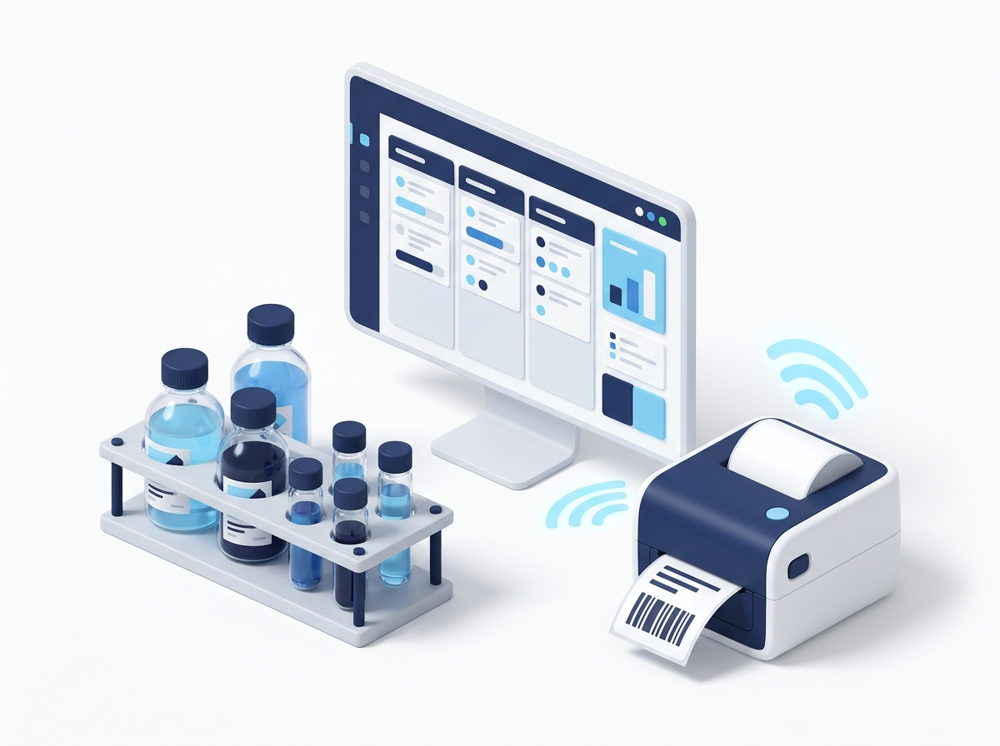
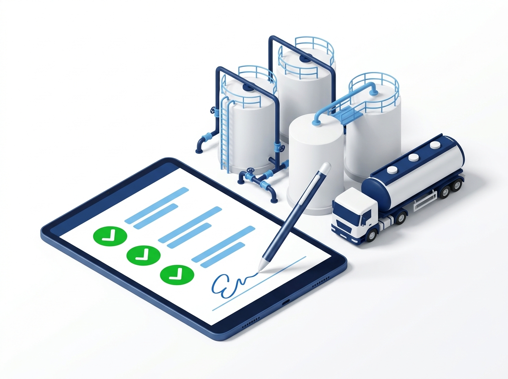
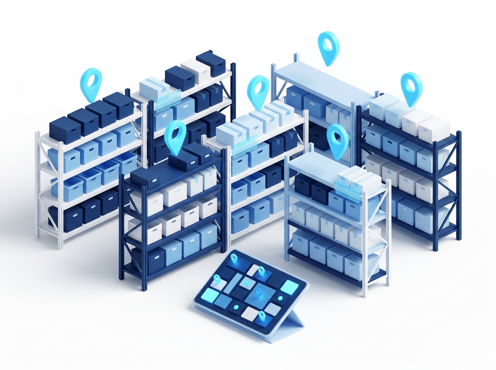
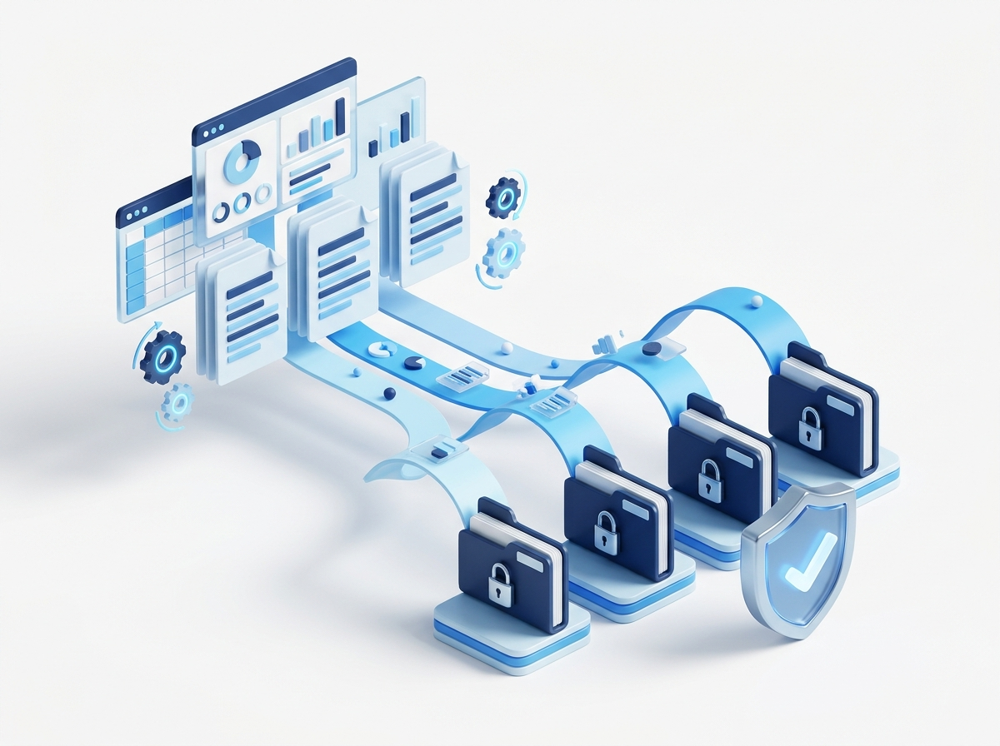
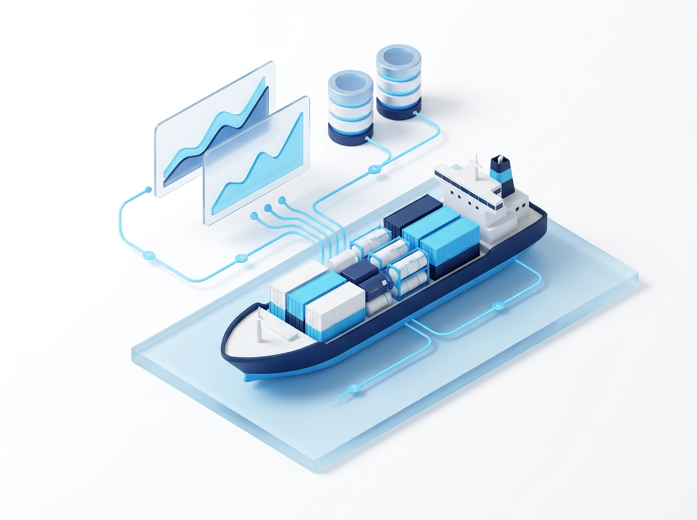
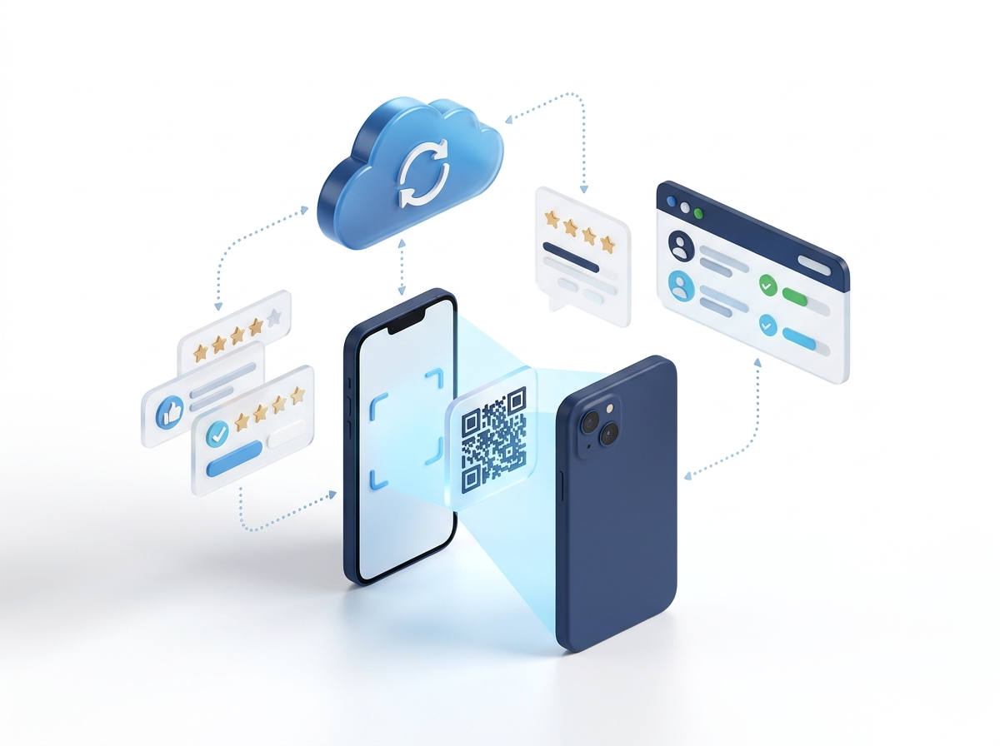

# 2026 數位轉型與 AI 系統開發成果發表

鴻勝化學 × 智慧工廠 · 無紙化檢點 · AI 防呆核對 · 雲端自動化八大精選專案
發表日期：2026 年 11 月 ｜ 製作人：shihwei0809

## 成果總覽：八大核心專案一覽表

| 編號 | 專案名稱 | 應用領域 | 核心架構與部署 | 關鍵成果亮點 |
| --- | --- | --- | --- | --- |
| 01 | QC 檢驗即時看板與 TSC 行動直印 | 品管檢驗 | Cloudflare Pages + D1 + LAN 代理 | D1 索引瘦身、TSC 90x60mm 秒出紙 |
| 02 | 台積三合一單與 COA AI 視覺核對 | 出貨防呆 | PWA + OCR + Cloudflare D1 (V50) | 5 重嚴格防呆，100% 攔截誤拍三合一單 |
| 03 | SOP / WI 檢查表電子化檢點系統 | 現場無紙化 | 三軌架構 + Cloudflare D1 共用庫 | 6.1～6.5 全上線、50 人併發 0.47s 零錯 |
| 04 | 倉儲儲位管理 PWA 系統 | 智慧倉儲 | PWA 離線快取 + Cloudflare D1 | 管轄 2,635 格儲位、跨倉誤匯鎖定防呆 |
| 05 | 勝一 / 鴻勝四大出貨報表自動化 | 報表自動化 | Python 桌面系統 + 一鍵秒還原 | 三重核對零硬猜、COA 自動算量與回推 |
| 06 | 產銷動態計畫 & IPA 報價船期追蹤 | 產銷決策 | 三軌架構 + 每日自動爬蟲 + D1 | 追蹤 364 筆國際報價與船期匯率動態 |
| 07 | 企業活動簽到與滿意度雲端系統 | 企業行政 | Cloudflare Pages + D1 (v2.1.0) | 50 人同時報到 0.37s 零撞號、定時切問卷 |
| 08 | 企業 SOP 微電影教學與 AI 語音產線 | 教育訓練 | Google Flow + Colab T4 語音克隆 | 真人微電影混剪 ERP 實操作業教材 |

## 共用技術底座：三軌架構 × 零維護雲端工程

- **標準三軌架構設計**：核心系統同步具備「純網頁版 / 本機 PWA 離線版 / Cloudflare Pages + D1 雲端版」，兼顧零安裝體驗、斷網作業佇列補傳與跨裝置即時同步。
- **高併發與低耗能 D1 優化**：導入單列原子 SQL 寫入與配號（50 人併發零撞號）、針對查詢欄位補建 Covering Index、前端分頻快取與背景頁籤暫停，徹底杜絕雲端流量超額。
- **零管理員權限與防呆保護**：本機工具全面採用純 ASCII + CRLF 啟動檔、更新前雙重備份與 1 秒還原保護、純內網 HTTP 代理突破 iOS 安全封鎖，現場人員開箱即用。
- **AI 驅動永續維護標準**：每個專案標配 `README.md`、`SKILL.md`、`setup_env.ps1` 與自動產出 Word 操作手冊，實現跨電腦無縫交接與 AI 輔助快速迭代。

# 八大精選專案成果詳解

從品管現場、出貨防呆、無紙化檢點到 AI 影音教育訓練的全面落地實績

## 01. QC 檢驗即時看板與 TSC 行動直印系統 (v3.3.8)

- **解決痛點**：傳統紙本送樣追蹤不易、進料與出貨動向易誤植，且手機跨網段列印標籤版面易跑位或被瀏覽器安全機制阻擋。
- **核心功能**：整合 T100 ERP 槽車排程匯入、ESPM（進料）/ ESXM（出貨）單號前綴自動強制對齊，以及 Teams 逾期檢驗自動推播預警。
- **行動直印突破**：建置免管理員權限純內網 HTTP 代理伺服器，手機開同源網址即可一鍵直通 TSC 標籤機（192.168.3.128:9100）精準印出 90×60mm 條碼貼紙。
- **效能優化實績**：補建 D1 複合索引並實施前端 60 秒背景暫停輪詢與分頻快取，大幅削減 90% 以上無效資料庫讀取。
- **線上正式站**：https://qc-samples.pages.dev

## 02. 台積三合一單與 COA AI 視覺雙重核對系統 (V50)

- **解決痛點**：電子級化學品出貨規格嚴苛，傳統人工肉眼核對三合一條碼單、地磅單與 COA 報告書耗時且容易因疲勞漏判。
- **核心功能**：現場人員以手機拍攝三合一單、地磅過磅單與 COA 報告，系統透過 OCR 自動比對地點、槽號、系統批號與料號。
- **5 重嚴格防呆卡控**：自動偵測並 100% 攔截「誤拍三合一單充當地磅單」、強制驗證台積過磅單 ESXM 特徵、攔截誤拍 COA 與重複照片，杜絕假成功漏洞。
- **行動 PWA 體驗**：Service Worker 自動偵測新版無感更新，歷史異常紀錄完整留存雲端 D1 看板供品保稽核追溯。
- **線上正式站**：https://coa-check-pwa.pages.dev

## 03. SOP / WI 檢查表電子化檢點系統 (6.1～6.5 全系列)

- **解決痛點**：27 頁儲槽進出貨紙本檢點表填寫繁瑣、溢槽容積需人工手算、主管補簽與歷史表單歸檔調閱困難。
- **完整數位化**：涵蓋 6.1 槽車泵料入儲槽、6.2 油槽車安檢清潔、6.3/6.4 ISO TANK 作業與取樣、6.5 放櫃前檢點，共 5 大表單與 3 種通用版型引擎。
- **現場防呆與簽核**：6.1 內建 `(A)-(B)=(C)` 容積與 M/T 溢槽自動試算、多台並行雲端暫存供品管跨機補簽、組長與課長常用手寫簽名庫一鍵呼叫。
- **原格式匯出與壓測**：支援 1:1 A4 PDF 列印與 ExcelJS 原生 `.xlsx`（嵌入透明手寫簽名圖），實測 50 人同時寫入僅 0.47 秒、100% 零失敗。
- **線上正式站**：https://wi-checklist-system.pages.dev

## 04. 倉儲儲位管理 PWA 系統 (v1.0.22)

- **解決痛點**：多廠區倉儲儲位龐大，傳統 Excel 巨集表難以在現場即時查詢與盤點，且跨倉庫匯入資料時易發生覆蓋風險。
- **全倉數位納管**：整合崙尾倉（1,775 格儲位）與鴻勝倉（860 格儲位）共 2,635 格儲位，支援中文字代碼與自然排序顯示。
- **智慧操作體驗**：自訂可輸入模糊搜尋品名選單、依品號動態過濾倉庫現存批號、支援人員帳號 Excel 批次匯出與匯入管理。
- **跨倉庫誤匯防呆**：批次匯入時自動辨識儲位格式歸屬，若目標倉庫不符立即觸發紅色警示並鎖定匯入按鈕，確保帳料安全。
- **線上正式站**：https://storage-rack-pwa.pages.dev

## 05. 勝一 / 鴻勝四大出貨報表自動化產生系統

- **涵蓋系統**：勝一小包系統報表產生、勝一三合一單產生系統、鴻勝三合一單自動產生器、鴻勝 N 系列小包報表系統。
- **精準核對零硬猜**：PR 生產履歷與 COA 匯入採「批號 + 出貨日 + FabPhase」三重核對，全面移除硬編碼猜測，查無代號立即警示防呆。
- **自動化規則計算**：COA 自動依 `桶數 × 200` 計算出貨量並自動回推 `交期 - 1 天` 完工日；廠區資料夾與檔名全面標準化（如 F5 帶入品名）。
- **企業級安全更新機制**：四套系統全面實裝純 ASCII 防閃退啟動腳本、更新前雙重備份、Python 語法自我檢測與「1 秒還原上一版」保護。

## 06. 鴻勝產銷動態計畫 & IPA 報價與船期追蹤平台

- **解決痛點**：化學品原物料國際行情與船期瞬息萬變，產銷動態計畫分散於多份試算表，難以即時整合決策。
- **雙平台整合**：結合「鴻勝產銷動態計畫系統（三軌版）」與「IPA 報價與船期追蹤系統」，支援瀏覽器即時運算與 Excel 雙向匯出入。
- **每日自動情報爬蟲**：排程每日自動抓取國際化學品報價（累計 364 筆以上）、船期追蹤（17 筆以上）與即時匯率，供採購與產銷即時掌握趨勢。
- **雲端資料庫瘦身**：完成跨專案 D1 共用主庫無損整合，將雲端資料庫精簡至 6 / 10 庫，零資源浪費且保留充足擴充彈性。
- **線上正式站**：https://ipa-quote-vessel-tracker.pages.dev

## 07. 企業活動簽到與滿意度調查雲端系統 (v2.1.0)

- **解決痛點**：大型企業活動或教育訓練現場報到排隊塞車、人工統計出席與紙本滿意度問卷回收率低、彙整耗時。
- **極速高併發報到**：改採 SQL 單列原子寫入與配號，實測 50 人同時掃碼報到僅需 0.37 秒，達成 100% 零錯誤、零覆蓋、零撞號。
- **高度彈性後台**：核對清單、宣導警語獨立開關與自由改名，支援手動補簽、代簽核准、斷網離線佇列自動補傳。
- **台灣時間定時切問卷**：強制 UTC+8 伺服器校時，活動結束時間一到前台自動無縫切換為滿意度調查表單，大幅提升問卷填答率。
- **線上正式站**：https://event-checkin-system.pages.dev

## 08. 企業 SOP 微電影教學與 AI 語音克隆自動化產線

- **解決痛點**：傳統文字版 SOP 員工閱讀意願低、新進同仁上手慢；委外拍攝教學影片成本高昂且流程修改難以重拍。
- **首創雙軌混剪路線 B**：將 Google Flow 角色一致性真人微電影過場，無縫穿插 ERP / BPM 系統真實操作截圖（如《BPM 一般費用報銷單私車公用教學》），大幅節省算力同時維持 100% 會計防呆嚴謹度。
- **免費雲端語音克隆**：整合 Google Colab T4 免費 GPU 執行 BreezyVoice 台灣國語與 VoxCPM2 語音克隆，自動進行 Whisper 校對與 -16 LUFS 音量標準化。
- **高保真自動後期引擎**：導入 Lanczos 銳化演算法根治介面模糊、自動個資馬賽克、0.4 秒轉場溶解與背景音樂自動閃避，快速產出 1080p 商業級教材。

## 量化成效與系統可靠度驗證

| 驗證維度 | 代表系統 | 實測指標與成果 |
| --- | --- | --- |
| 高併發寫入壓測 | SOP/WI 電子檢點、活動簽到系統 | 50 人同時併發 0.37s～0.47s，100% 零失敗、零撞號 |
| 雲端資料庫效能 | QC 看板、溫度監控系統 | 補建 D1 Covering Index，單次查詢 10,057 列降至 1 列 |
| 現場作業防呆 | 三合一單核對 V50、四大報表、儲位 | 5 重 OCR 攔截、三重核對零硬猜、跨倉庫誤匯鎖定 |
| 數位資產規模 | 倉儲儲位 PWA、IPA 報價追蹤 | 納管 2,635 格儲位、364 筆＋國際報價與全廠 5 大檢點表 |
| 系統維護與安全 | 四大報表、所有 Cloudflare 系統 | 1 秒還原機制、D1 共用主庫瘦身至 6/10 庫、全附 Word 手冊 |

## 未來展望與持續演進

- **全廠無紙化深化**：將 SOP / WI 電子檢點引擎持續推廣至更多工站與設備巡檢表單，全面落實 ESG 無紙化目標。
- **AI 視覺與自動預警整合**：結合 Gemini 多金鑰輪詢與最新動態模型偵測，擴大 OCR 異常辨識與 Teams 即時預警覆蓋率。
- **影音教材規模化複製**：運用 `sop-cinema-video` 標準化產線，將各部門核心作業標準快速轉化為生動易懂的微電影數位課程。
- **跨裝置統一入口治理**：透過 Cloudflare Pages 線上專案大廳統一納管所有工具，實現零門檻推廣與永續自主維運。

# 感謝聆聽 · Q&A

鴻勝化學 數位轉型與 AI 系統開發成果發表
歡迎交流指教！
