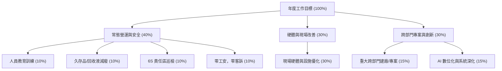

# 📋 資材課年度工作目標達成狀況與績效考核自評總整手冊

> **文檔定位**：本手冊完整留存「年度工作目標達成狀況明細（7大項）」與「考核人說明（自評與建言）」，已精確配平 100% 權重與各項成果量化數據，供年度考核存檔及**明年度（2027年）考核快速參照、沿用與升級**。
> **歸檔日期**：2026年11月18日  
> **加權自評總分**：**89.0 分**（總權重 100%）

---

## 壹、工作目標達成狀況明細（全年度 7 大項總表）

| 序號 | 目標/職掌描述 | 權重(%) | 成果描述 | 員工自評(分數) | 員工自評-按比例 |
| :---: | :--- | :---: | :--- | :---: | :---: |
| **1** | **現場操作及環境改善** | **30%** | 1. 崙尾危倉儲存溫度改善 - 1/29已完工驗收。 2. 舊槽區32個儲槽加裝儲槽電子式微壓表 - 2026Q3完成。 | 90 | 27.0 |
| **2** | **人員教育訓練課程** | **10%** | 呼吸閥動作原理講解、氮封系統動作原理講解及每月SOP導讀及改版說明。 | 90 | 9.0 |
| **3** | **久存品取樣控管** | **10%** | 全年持續執行和久存品限縮處理，已把EBR、NBAC、CPN 回收液單獨分開，預估每月減少廢液約4-5T。 | 90 | 9.0 |
| **4** | **劃分人員6S責任區域** | **10%** | 劃分安全責任區，人員每月巡檢乙次以上。 | 85 | 8.5 |
| **5** | **零工安，零客訴** | **10%** | 本年度無發生工安，客訴，2025年發生一件工安事件。 | 85 | 8.5 |
| **6** | **L01跨部門專案** | **15%** | 1. 第一階段計劃4/30前需完成三顆電子級與一顆原料儲槽清洗完成，提早於4/15完成。 2. 第二階段計劃6/30前需完成五顆電子級與一顆原料儲槽清洗完成，提早於6/5完成。 | 90 | 13.5 |
| **7** | **現場AI數位化與防呆系統推進** | **15%** | 1. 三合一單自動產出與核對系統 - 現場作業時間節省50%以上，資料正確率100%。 2. 軟管與包裝條碼對刷防呆 - 計劃達到全年0混料。 3. QC即時看板與環境溫度警告。 | 90 | 13.5 |
| **合計** | **全年度工作目標總計** | **100%** | — | — | **89.0 分** |

---

## 貳、考核人說明（自評總結與建言）

### 一、請說明今年度的整體表現
*(亦可補充特殊事項，舉例：向董事長報告、提出改善事項、流程簡化、修訂作業標準、參與跨部門專案、參加OO研討會、擔任內部講師、...等)*

> **今年度工作重心聚焦於「現場作業簡化、防呆機制建立、團隊知識傳承」，整體執行成效如下：**
> 
> 1. **深化現場防呆與數位化落地**：持續推動課內各項作業工具（排程進耗存、條碼核對、單據報表自動化與異常通報）的穩定運行與使用率，讓第一線同仁操作更直覺、出錯率降到最低。
> 2. **強化團隊培育與接班梯隊**：持續完善圖文 SOP、製程流程圖與教育訓練測驗機制，縮短新人養成週期，並培養資深同仁獨立處理異常的能力，減輕課務對單一人員的依賴。
> 3. **提升跨部門溝通效能**：在課與課之間的銜接點（如生產、品管、倉儲出貨）主動對齊資料與流程規範，減少跨單位重複確認的內耗。

---

### 二、您對自己的期許，或對主管及公司的建議？

> 1. **推動跨單位作業規格標準化**：許多現場系統與自動化工具需要上下游部門配合一致的格式或刷碼流程才能發揮最大效益，期盼公司高層／主管能協助制定統一標準並由上而下推動，加速系統整合落地。
> 2. **建立改善成果的橫向複製機制**：課內已驗證有效的防呆工具、離線作業模式與訓練系統，若能透過公司平台分享給其他單位參考或沿用，能避免各單位重複摸索，創造更大的整體效益。

---

## 參、明年度（2027年）快速沿用與修改指南

當明年填寫考核或設定新年度目標時，可將上述項目分為**「常態核心項目」**與**「專案性項目」**快速微調：

### 1. 常態核心維運項目（權重 40%：每年固定沿用，僅需更新累計數據）
- **教育訓練 (10%)**：更新年度重點導讀之新版 SOP 名稱或新系統實機測驗成效。
- **久存品與減廢 (10%)**：延續 EBR/NBAC/CPN 分流去化成果，更新去化噸數（例如：*「累計全年減少廢液約 50~60 噸」*）。
- **6S 責任區域 (10%)**：填報每月巡檢次數、缺失改善率（如：*「每月巡檢乙次以上，現場缺失整改率 100%」*）。
- **零工安零客訴 (10%)**：持續以「全年度 0 工安、0 客訴」為標準，展現團隊安全穩定度。

### 2. 現場工程改善項目（權重 30%：隨新年度工程工項動態調整）
- **2026 年實績**：危倉溫度改善驗收、舊槽區 32 顆微壓表完工。
- **2027 年填寫建議**：改為新年度的硬體投資或改善專案，例如：
  - *「儲槽區電子式微壓表連線數據監控與異常自動通報全面上線」*
  - *「新儲槽或管線閥件防護工程驗收」*

### 3. 專案與 AI 數位化項目（權重 30%：深化成果與橫向複製）
- **跨部門專案 (15%)**：接續 L01 新廠地磅完工後續工程或產線驗收進度（如地磅正式投產啟用）。
- **AI 數位化防呆 (15%)**：
  - 三合一單系統跨廠區或跨部門推廣。
  - 條碼對刷與 ERP / T100 QC 系統深度整合，全面達成無紙化與即時雲端追溯。
